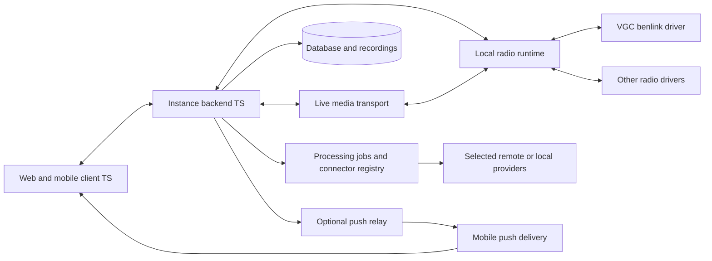

# Product and architecture

## Product boundary

SignalDock connects clients to self-hosted instances containing multiple radios. The hierarchy is **instance → radio → frequency conversation → communication**. A radio is an operational resource backed by a configured driver and any required control/audio/PTT components. Location/site grouping can be added without changing that identity.

An instance owns its users, recordings, processing settings, and permissions. Independent instances do not share accounts or histories by default. A published client is a distribution convenience, not a requirement to use a central backend.

Core operation must work without paid credentials: local authentication, radio control, available live audio, recording, and history remain usable. External speech, analysis, and push are optional capabilities with visible status.

## Proposed structure

The backend starts as a modular Node.js/TypeScript application, proposed with NestJS/Fastify. Modules cover identity, radios, control, history, processing, incidents, APRS, notifications, and administration. Background workers reuse domain contracts rather than turning every module into a separate service.

The local radio runtime supervises hardware drivers close to their devices. Drivers are separate processes behind a versioned internal API. The optional push relay is a separate deployable service with separate credentials and a narrow delivery role.

Proposed code boundaries: `apps/client`, `apps/api`, `apps/worker`, `apps/push-relay`, `services/radio-runtime`, `services/drivers/vgc-benlink`, `packages/contracts`, `packages/client-sdk`, `packages/radio-driver-sdk`, `packages/processing-sdk`, `packages/ui`, and `deploy`.

## Operating invariants

- One tuning owner and one transmitter per radio; multiple listeners are allowed.
- Two independent radios may have different operators and frequencies. Shared physical resources require an additional resource-group lock.
- A user session initially transmits on only one radio at a time. Selecting another radio releases pending TX intentions first.
- Reconnection and retries never replay a previous transmission.
- A process restart does not restore an application state as physically transmitting; the driver reconciles actual state.
- Processing and notification failures must not block recording or local PTT supervision.
- Desired, observed, and uncertain radio states are separate values.

## Quality targets

NFR-01: no cross-instance credential, event, media, or cache leakage. NFR-02: independent radio state and locks. NFR-03: commands and events carry correlation and generation information. NFR-04: bounded audio buffers and processing queues. NFR-05: visible partial failures. NFR-06: protocol compatibility independent of synchronized app/backend releases.

Initial performance target: under one second of end-to-end audio latency on a stable LAN, measured including Bluetooth and transcoding. This is a provisional target, not a demonstrated property. Measure PTT acquisition, actual RF release, audio loss, storage growth, and CPU/memory on target hardware before finalizing thresholds.

## Acceptance

Start without hardware using two different simulated driver capability sets. Connect two users, operate the radios independently, preserve history during worker failure, and replace a driver without changing frontend business logic. Physical acceptance remains a separate gate from simulated API tests.
